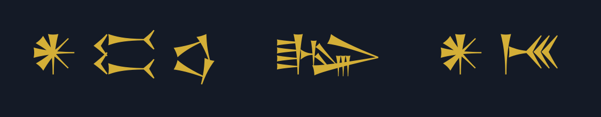
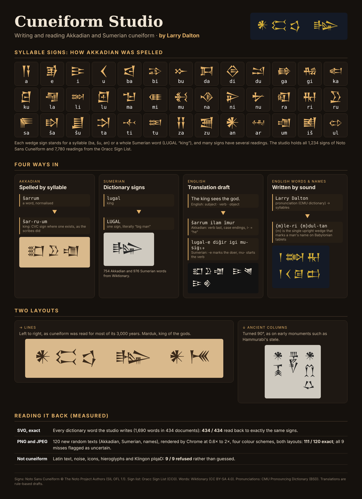
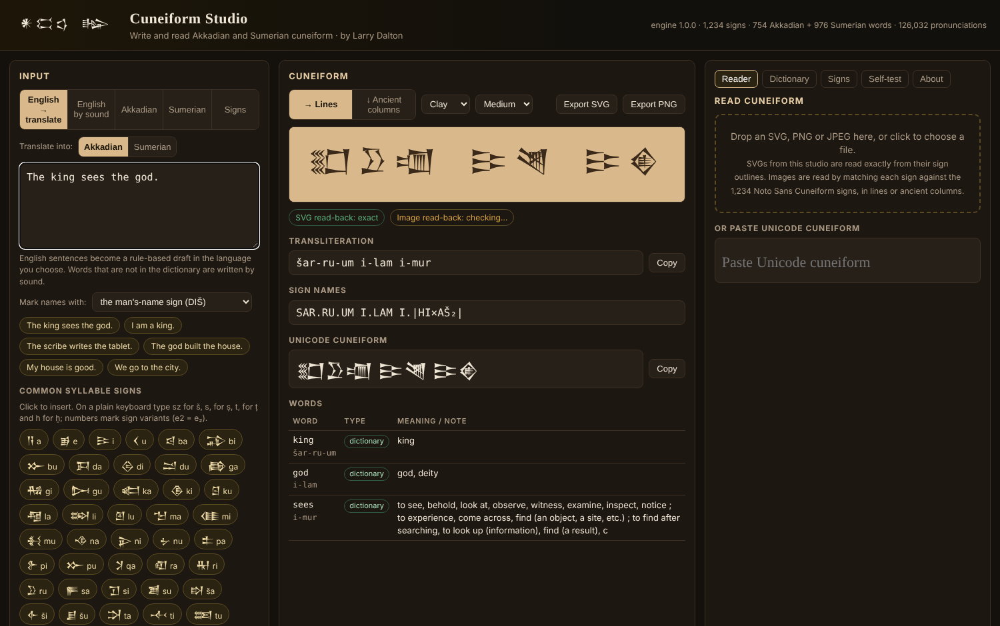
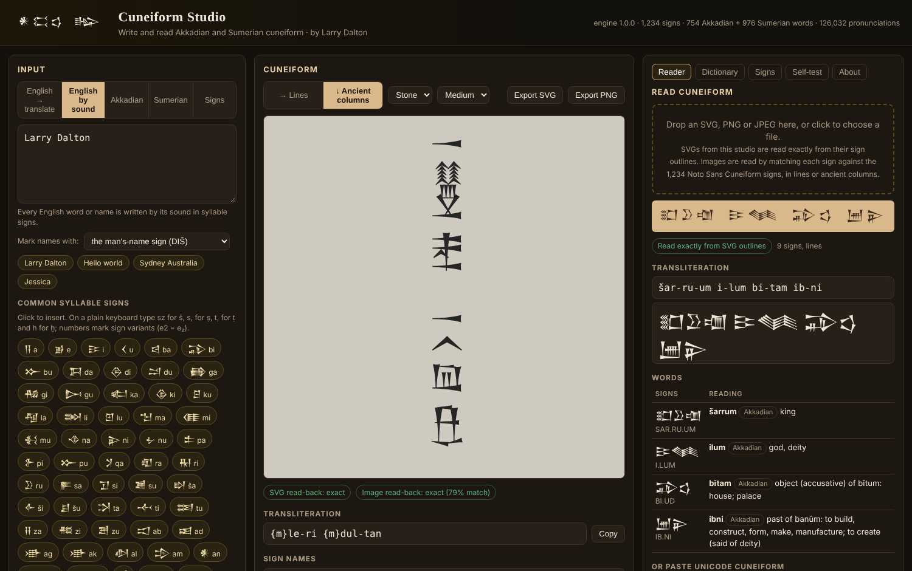

<p align="center"></p>

<h1 align="center">Cuneiform Studio</h1>
<p align="center"><b>Write and read Akkadian and Sumerian cuneiform. By Larry Dalton.</b><br>
A local Windows studio that turns Akkadian, Sumerian, English and names into cuneiform, drafts English to Akkadian or Sumerian translations, and reads cuneiform back from SVGs and images.</p>

<p align="center">
<a href="../../releases/latest"><b>Download for Windows</b></a> ·
<a href="docs/HOW-IT-WORKS.md">How it works</a> ·
<a href="docs/READER.md">Reader and test results</a> ·
<a href="NOTICE.md">Credits and licences</a>
</p>



---

## What it does

| Input | What happens |
|---|---|
| **English → translate** (`The king sees the god.`) | A rule-based **draft** in the language you choose. **Akkadian:** subject, object, verb last, case endings, past tense with person prefixes, the stative for "is" with adjectives and nominal sentences with nouns (*šarrum ilam īmur*, *šarrāku* "I am king", *ilum rabi* "God is great"), "and" (*u*) and "of" with the construct state (*Marduk šar ilī* "Marduk is the king of the gods"). **Sumerian:** the doer marked with -e, the verb with mu-, the copula -am₃, the genitive -ak (*lugal-e dig̃ir igi mu-sig₁₀*, *ᵈamar-utu lugal dig̃ir-me-eš-ak am₃*). Every draft shows its confidence and a word-by-word breakdown. |
| **English words and names** (`Larry Dalton`, `Jesus god`) | Words the dictionary knows are written with their **word sign**, as the scribes did: *god* → DINGIR, *king* → LUGAL, *fish* → KU₆, *Marduk* → {d}AMAR-UTU, *Babylon* → BABILIM₂{ki}. Everything else is written by sound in syllable signs, the way foreign names were written in Babylonia; words with a capital letter get the man's-name, woman's-name or god sign in front: *{m}le-ri {m}dul-tan*. Word signs can be switched off to write everything by sound. |
| **Akkadian** (`šarrum`, `šar-ru-um`) | Normalised words are split into syllables and written as the scribes did, with a CVC sign where one exists (*šar-ru-um*). Syllabic spellings are written exactly. |
| **Sumerian** (`lugal`, `e2`, `dingir`) | Dictionary words use their dictionary signs (LUGAL "king", E₂ "house"). Plain-keyboard spellings work: `e2` = e₂, `ng` = g̃, `sz` = š. |
| **Signs** (`{d}AMAR.UTU`, `a-na be-li2-ia`) | Exact transliteration: values joined by hyphens, sign names in capitals, markers in braces (`{d}` god, `{m}` man, `{f}` woman, `{ki}` place). |

Two layouts: **lines** (left to right, as cuneiform was read for most of its history) or **ancient columns** (turned 90°, read top to bottom and right to left, as on Hammurabi's stele).

Output can be exported as SVG or PNG, or copied as transliteration or **Unicode cuneiform**. The dictionary tab searches 754 Akkadian and 976 Sumerian words in English or either language; the signs tab looks up any of the 3,244 Oracc signs by name or reading.



## Reading it back

- **SVG:** read exactly from the sign outlines (never from the embedded metadata), in either layout.
- **PNG and JPEG:** each sign is matched against all 1,234 Noto Sans Cuneiform signs; lines, signs and words are rebuilt, and ancient columns are detected by turning the image.
- **Words:** readings are chosen from each sign's values to find dictionary words, including inflected Akkadian forms (*bītam*, object of *bītum* "house"; *ibni*, past of *banûm* "to build"). Names come back as syllables with likely English source words.
- **Unicode:** paste Unicode cuneiform to get sign names, transliteration and word readings.

| Test | Result |
|---|---|
| Every dictionary word the studio writes (1,690 words in 434 SVGs) | **434 / 434** read back to exactly the same signs |
| 120 new random texts as PNG/JPEG (Akkadian, Sumerian, names), 0.6× to 2×, four colour schemes, both layouts | **111 / 120 exact**; all 9 misses were flagged as uncertain |
| Images that are not cuneiform (Latin text, noise, icon, hieroglyphs, pIqaD, Heptapod) | **9 / 9 refused** (these images were also used to set the refusal threshold) |
| Built-in self-test, in the studio page | **22 passed, 0 failed** |

Many cuneiform signs differ by a single wedge, so image reading can confuse near-identical signs. **Use SVG for exact results.** Details: [docs/READER.md](docs/READER.md).



## Install (Windows 10/11)

**Option 1: setup program.** Download `CuneiformStudio-Setup.exe` from the [latest release](../../releases/latest) and run it.

- Installs for your Windows account only; no administrator rights needed.
- Runs at **http://localhost:8768/** and starts when you sign in. (Hieroglyph Studio uses 8767, pIqaD Studio 8766 and Heptapod L Studio 8765, so all four can run together.)
- Puts the infographic on your Desktop and adds a Start-menu entry and an uninstaller in *Settings → Apps*.

The setup program is not code-signed, so SmartScreen may warn: choose **More info → Run anyway**.

**Option 2: ZIP.** Download `CuneiformStudio-Package.zip`, extract it and double-click **Install.cmd**.

Both run the same checked install: back up any previous version, free port 8768 only if the previous Cuneiform Studio holds it, copy the files, start the server, verify the page, engine, sign outlines, word list, sign table, font, pronunciations and folder protection over HTTP, and restore the previous version if anything fails.

**Run from source:** `powershell -ExecutionPolicy Bypass -File src\server.ps1 -Open`

Everything runs on your computer. No internet connection, no cloud services, no AI.

## Limitations

- Translations are rule-based drafts from small word lists (754 Akkadian, 976 Sumerian words). Short, simple sentences work best; they are a starting point, not fluent translation. Akkadian drafts are capped at 75% confidence and Sumerian at 60%.
- Sumerian verb chains are simplified to the mu- prefix; Sumerian grammar is far richer than the studio models.
- Names written by sound are approximations and read back as syllables, not spellings.
- One sign style (Noto Sans Cuneiform, Neo-Assyrian-like shapes). The image reader does not read photographs of tablets or handwriting.

## Repository layout

```
src/server.ps1        Local web server (Windows PowerShell 5.1), http://localhost:8768/
src/app/              Studio: index.html, engine.js, data/, fonts/, licenses/
installer/            Install.ps1, Uninstall.ps1, NSIS script, ZIP launcher, icon
infographics/         How it works
tools/                Data builder (signs, words, outlines), pronunciation table builder, infographic generator
test/                 Node and browser test harnesses, test cases, refusal images
docs/                 How it works, reader notes, images
```

## Credits

- Signs: **Noto Sans Cuneiform** © The Noto Project Authors, SIL Open Font License 1.1.
- Sign list and readings: **Oracc Sign List** (OSL), CC0.
- Words: **Wiktionary** Akkadian and Sumerian entries (via kaikki.org), CC BY-SA 4.0.
- Pronunciations: **CMU Pronouncing Dictionary**, BSD licence.

The word list (`src/app/data/lexicon.json`) is shared under CC BY-SA 4.0. See [NOTICE.md](NOTICE.md).

## Author

**Cuneiform Studio** was created by **Larry Dalton**. Studio software © 2026 Larry Dalton. Third-party components keep their own licences.
